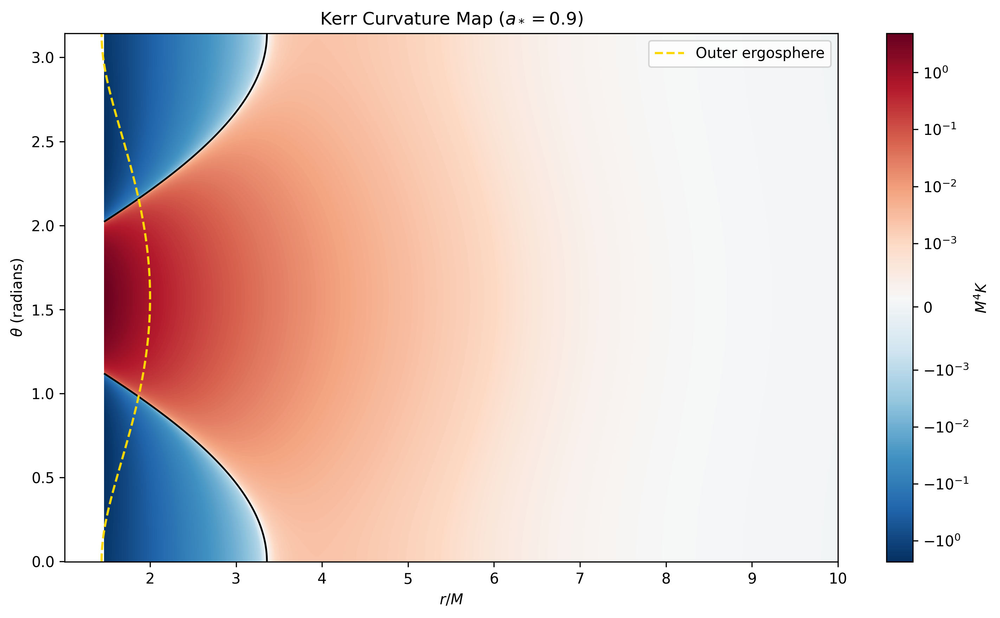
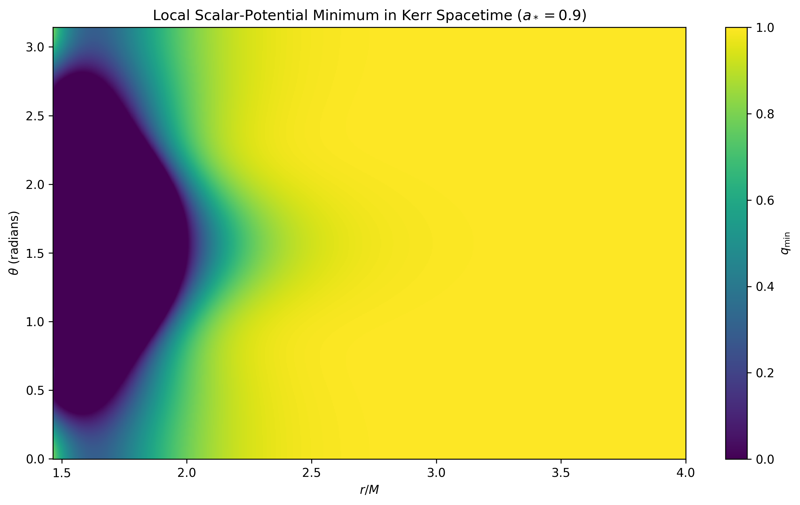
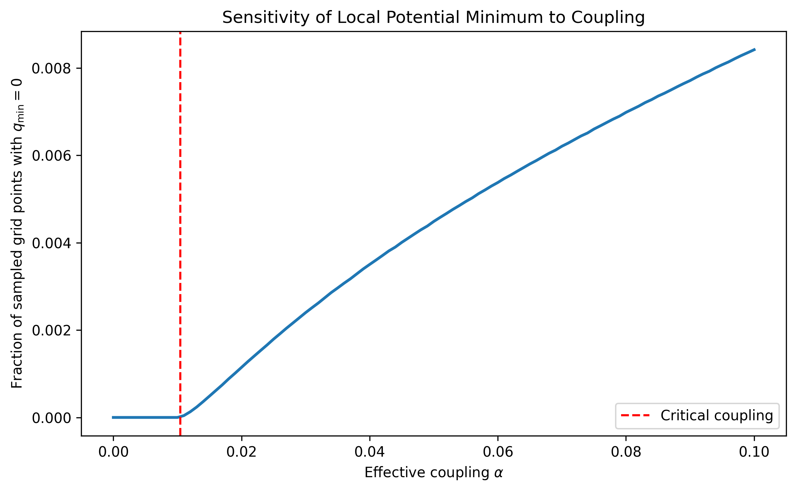

# Curvature-Gradient Couplings and a Higgs-Like Scalar Potential in Kerr Spacetime

### A Numerical Toy-Model Study

## 1. Overview

This project investigates how a hypothetical interaction between spacetime curvature gradients and a Higgs-like scalar field modifies the local minimum of a scalar potential around a rotating Kerr black hole.

The computational framework combines:
* The Kerr Kretschmann scalar
* Analytical radial and angular curvature derivatives
* A curvature-gradient invariant
* A phenomenological trial potential, $W_{\mathrm{trial}}$
* Numerical validation and coupling-sensitivity analysis

**Scientific scope:** This is an exploratory numerical toy-model study, not a prediction of Standard Model Higgs vacuum instability.

---

## 2. Mathematical Framework

### 2.1 Kerr Spacetime

We consider a Kerr black hole in Boyer–Lindquist coordinates.

The dimensionless radial coordinate is defined as

$$
x = \frac{r}{r_g}
$$

where the gravitational length scale is

$$
r_g = \frac{G M_{\mathrm{BH}}}{c^2}.
$$

The dimensionless black-hole spin parameter is

$$
a_* = \frac{Jc}{G M_{\mathrm{BH}}^2},
$$

where $J$ is the black hole's angular momentum.

The outer event horizon is located at

$$
x_+ = 1 + \sqrt{1-a_*^2}.
$$

We define the dimensionless Kretschmann scalar as

$$
\mathcal{K}(x,\theta)
=
r_g^4 R_{\mu\nu\rho\sigma}R^{\mu\nu\rho\sigma}.
$$

For Kerr spacetime, this becomes

$$
\mathcal{K}(x,\theta)
=
\frac{
48\left(
x^6
-15a_*^2x^4\cos^2\theta
+15a_*^4x^2\cos^4\theta
-a_*^6\cos^6\theta
\right)
}{
\left(x^2+a_*^2\cos^2\theta\right)^6
}.
$$

Here, $R_{\mu\nu\rho\sigma}$ is the Riemann curvature tensor.

The Python variable `K` represents the dimensionless quantity $\mathcal{K}$, rather than the dimensionful physical Kretschmann scalar.

### 2.2 Curvature-Gradient Invariant

We construct the dimensionless curvature-gradient invariant

$$
G_K= \frac{\Delta}{\Sigma} \left(\frac{\partial K}{\partial x}\right)^2 + \frac{1}{\Sigma} \left(\frac{\partial K}{\partial\theta}\right)^2,
$$

where

$$
\Delta=x^2-2x+a_*^2,
$$

$$
\Sigma=x^2+a_*^2\cos^2\theta.
$$

Analytical derivatives are used to calculate $G_K$. Numerical finite-difference derivatives provide an independent accuracy check.

The physical curvature-gradient invariant is related to this dimensionless quantity by a factor of $r_g^{-10}$.

### 2.3 Proposed Trial Potential

The central phenomenological model investigated in this project is

$$
W_{\mathrm{trial}}(q,x,\theta) = -\mu^2q+\lambda q^2 +\frac{\gamma}{\hat{\Lambda}^8}G_K(x,\theta)q
$$

where:
* $q\geq0$ is a dimensionless, nonnegative scalar-amplitude variable.
* $\mu^2$ is the dimensionless quadratic potential parameter.
* $\lambda>0$ is the quartic coupling.
* $\gamma$ is a hypothetical dimensionless curvature coupling.
* $\hat{\Lambda}$ is a dimensionless cutoff parameter.
* $G_K$ is the curvature-gradient invariant.

We define the effective coupling

$$
\alpha=\frac{\gamma}{\hat{\Lambda}^8}.
$$

The curvature-dependent interaction is introduced as a phenomenological assumption. It is not derived from the Standard Model or an established theory of quantum gravity.

### 2.4 Local Potential Minimum

Minimizing the trial potential with respect to $q$, subject to $q\geq0$, gives

$$
\frac{\partial W_{\mathrm{trial}}}{\partial q} = -\mu^2+2\lambda q+\alpha G_K=0.
$$

Therefore,

$$
q_{\min}(x,\theta) = \frac{\max\left[\mu^2-\alpha G_K(x,\theta),0\right]}{2\lambda}
$$

This expression describes the local minimum of the assumed potential at each coordinate point.

It does not represent a solution of the full scalar-field equation, since spatial-gradient and kinetic contributions are neglected.

---

## 3. Numerical Methodology

The numerical implementation uses Python, NumPy, and Matplotlib.

### Baseline Parameters

| Parameter | Value |
| :--- | :--- |
| Dimensionless Kerr spin, $a_*$ | 0.9 |
| Radial coordinate | $1.02x_+\leq x\leq10$ |
| Radial grid points | 2400 |
| Angular grid points | 1081 |
| Quadratic parameter, $\mu^2$ | 1.0 |
| Quartic coupling, $\lambda$ | 0.5 |
| Dimensionless cutoff, $\hat{\Lambda}$ | 1.0 |
| Hypothetical coupling, $\gamma$ | 1.0 |
| Effective coupling, $\alpha$ | 1.0 |

The Kerr curvature scalar and its analytical derivatives are evaluated on a two-dimensional radial-angular grid.

The curvature-gradient invariant is then used to calculate the pointwise minimum of the trial potential.

A separate coupling scan examines how the result changes as $\alpha$ varies.

---

## 4. Numerical Results

### 4.1 Curvature-Gradient Invariant

For the baseline grid and black-hole spin,

$$
\max(G_K)\approx95.893488.
$$

The invariant is strongly dependent on position, particularly near the black hole.

### 4.2 Critical Effective Coupling

A sampled grid point first reaches $q_{\min}=0$ when

$$
\alpha G_K\geq\mu^2.
$$

The corresponding threshold on the sampled grid is

$$
\alpha_{\mathrm{crit}} = \frac{\mu^2}{\max(G_K)} \approx0.01042824.
$$

This is a model-dependent threshold for the chosen coordinate domain and sampling grid, not a universal physical phase-transition threshold.

### 4.3 Coupling Sensitivity

| Effective coupling | Fraction of sampled points with $q_{\min}=0$ |
| :--- | :--- |
| 0.01 | 0% |
| 0.1 | 0.8416% |
| 1.0 | 3.6691% |

Increasing the effective coupling increases the fraction of sampled points at which the constrained local potential minimum reaches zero.

These fractions describe the chosen coordinate grid, not a proper spacetime volume fraction.

### 4.4 Illustrative Physical-Scale Comparison

A separate calculation uses:
* Black-hole mass: $10M_\odot$
* Physical energy cutoff: 1 GeV
* Scalar mass parameter: 88 GeV
* Hypothetical coupling: $\gamma=1$

The resulting maximum ratio of the curvature correction to the quadratic mass parameter is approximately

$$
2.2483\times10^{-201}.
$$

This demonstrates extreme suppression under the stated illustrative assumptions.

However, the 1 GeV cutoff is below the 88 GeV scalar mass parameter. Consequently, this example is not presented as a controlled effective-field-theory prediction.

---

## 5. Figures

### Figure 1 — Kerr Kretschmann Scalar

The dimensionless Kretschmann scalar across the radial-angular grid for $a_*=0.9$. The figure includes the zero-curvature contour and outer ergosphere. The Kerr Kretschmann scalar is not positive-definite; negative values should not be interpreted as a general notion of negative spacetime curvature.

### Figure 2 — Local Scalar-Potential Minimum

The pointwise minimum of the hypothetical scalar potential near the rotating black hole. The displayed region emphasizes the spatial variation of $q_{\min}$ close to the event horizon. Regions with $q_{\min}=0$ represent the constrained minimum of the assumed local potential, not a demonstrated physical Higgs vacuum transition.

### Figure 3 — Effective Coupling Sensitivity

The fraction of sampled grid points with $q_{\min}=0$ as a function of the effective coupling $\alpha$. The dashed vertical line marks the critical coupling calculated for the sampled grid.

---

## 6. Numerical Validation

Several consistency checks were performed.

### Schwarzschild Limit
For vanishing black-hole spin,

$$
a_*=0,
$$

the Kerr Kretschmann scalar reduces to

$$
K=\frac{48}{x^6}.
$$

The numerical implementation reproduces this expression to floating-point precision.

### Equatorial Limit
At

$$
\theta=\frac{\pi}{2},
$$

the scalar reduces to

$$
K=\frac{48}{x^6}.
$$

The numerical implementation agrees with this analytical expression.

### Reflection Symmetry
The computed Kretschmann scalar satisfies reflection symmetry about the equatorial plane to floating-point precision.

### Derivative Comparison
Analytical derivatives were compared with numerical finite-difference estimates using second-order boundary approximations.

At the baseline grid resolution:

| Quantity | Maximum absolute error | Mean absolute error |
| :--- | :--- | :--- |
| Radial derivative | 0.002159 | 0.00000899 |
| Angular derivative | 0.000478 | 0.00000324 |

These comparisons provide useful numerical checks but do not constitute a complete grid-convergence or error-bound analysis.

---

## 7. Physical Interpretation and Limitations

The project is subject to several important limitations.

1. The curvature-gradient interaction is hypothetical, and its coupling is not derived from a fundamental theory.
2. The scalar potential is a simplified Higgs-like model, not the full Standard Model effective potential.
3. Renormalization-group running, quantum loop corrections, and vacuum decay rates are not calculated.
4. The local minimization neglects field-gradient energy and does not solve a globally self-consistent scalar-field configuration.
5. The physical validity of the effective-field-theory parameter choices has not been established.
6. The numerical threshold depends on the selected coordinate domain and grid.
7. The coupling-sensitivity results do not establish a physical vacuum phase transition.
8. The model does not include gravitational backreaction from the scalar field.

These limitations distinguish the computational behavior of the trial model from established physical predictions.

---

## 8. Conclusion

This project implements a numerical framework connecting Kerr spacetime curvature, analytical curvature derivatives, and a hypothetical curvature-gradient coupling to a Higgs-like scalar potential.

Within the chosen dimensionless toy-model regime, the curvature-dependent interaction produces spatially varying local potential minima and a calculable threshold for the onset of zero-minimum grid points.

The work demonstrates computational modeling, analytical implementation, numerical consistency checks, and parameter-sensitivity analysis.

The results are intended as an exploratory investigation of a phenomenological model rather than evidence of a new physical mechanism for Higgs vacuum instability.

---

## 9. Tools and Dependencies

* Python
* NumPy
* Matplotlib

The project uses standard numerical array operations and two-dimensional visualization.
